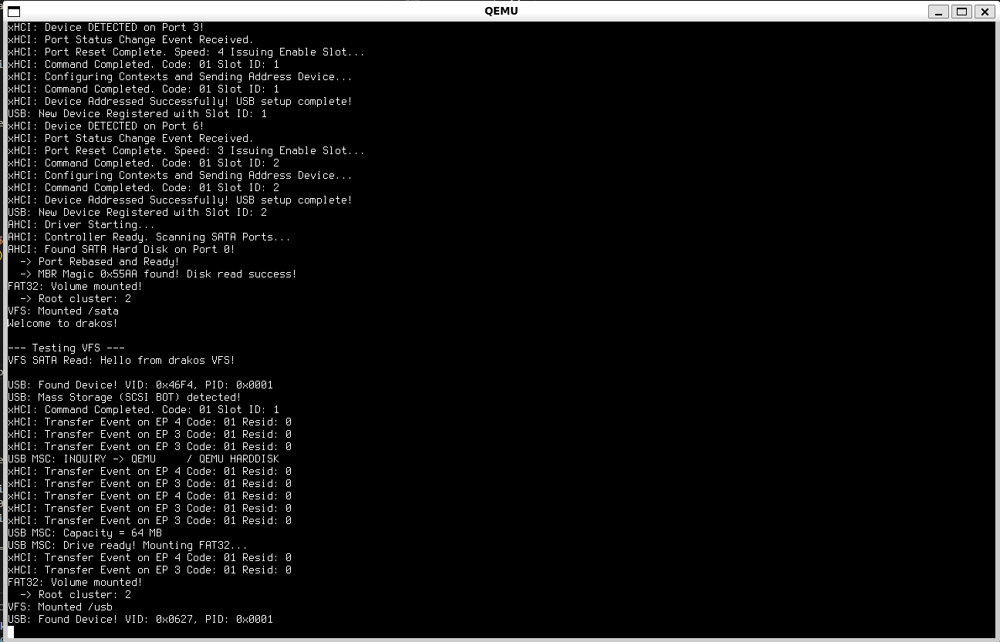

# drakos

Welcome to **drakos**! 🎮



drakos is an open-source, bare-metal operating system built from scratch in C++. 

> [!WARNING]
> ⚠️ I'm restarting the implementation in C++, I wasn't able to restart a project this big, so I'm continuing this in the hopes of achieving my goal.

## 🎯 Our Vision

drakos aims to turn a PC into a dedicated gaming machine by minimizing OS overhead and removing everything not required for gameplay.

The goal is not to replace desktop operating systems, but to build a console-like environment on standard PC hardware.

## Current development status

drakos is an early x86-64 kernel prototype. It includes a Limine UEFI boot path, memory management, interrupt and scheduler foundations, framebuffer text output, storage and USB driver prototypes, and a small experimental userspace. The boot and driver code is not a production system, and the Game Runtime, graphics APIs, emulators, and console-style interface are not implemented.

### Build prerequisites

The following commands must be available through `PATH`:

- `x86_64-elf-gcc`, `x86_64-elf-g++`, `x86_64-elf-ld`, and `x86_64-elf-as`
- `limine`, plus its UEFI boot support files. The Makefile checks the directory reported by `limine --print-datadir` and then the executable's standard installation prefix; set `LIMINE_DIR` if the files are installed elsewhere.
- `make`, `objcopy`, and `xorriso`

To create disk images or use the full `make run` target, QEMU, OVMF, `mtools` (`mcopy`), and FAT utilities are also required. `mcopy` is not needed to compile the kernel or make the boot ISO.

The compiler prefix and Limine executable/data directory can be overridden:

```bash
make CROSS_COMPILE=x86_64-elf- LIMINE=limine
```

### Build and boot test

Build the UEFI ISO:

```bash
make all
```

Boot it in a graphical QEMU window with the installed OVMF firmware:

```bash
qemu-system-x86_64 -cpu max -bios /usr/share/ovmf/OVMF.fd -cdrom drakos.iso -m 256M
```

The Limine menu defaults to normal mode after three seconds. Select **drakos (verbose)** for initcall status, error, and TSC-duration output, or **drakos (recovery)** for detailed boot diagnostics. Normal mode suppresses kernel console and serial log output; fatal errors show a short message and direct the developer to Recovery. Verbose and Recovery modes expose the technical details. Durations are raw TSC ticks and are not calibrated wall-clock times.

For serial smoke testing, add `-display none -serial stdio -monitor none` to the QEMU command. The kernel idles after initialization, so stop QEMU with Ctrl-C when the expected boot output has appeared.

Run the host-side initcall, font, PMM, VMM, and heap allocation checks with:

```bash
make test-initcalls test-font test-pmm test-vmm test-heap
```

The framebuffer text renderer decodes UTF-8 and uses the bundled PSF1 font's Unicode table for supported glyphs; unsupported codepoints display as `?`.

### Memory and process lifecycle status

Limine starts the reported application processors (APs), which load the kernel page tables and service synchronous TLB invalidation IPIs. Page-table operations are serialized by the VMM lock; a completed map/unmap waits for every online AP to acknowledge its invalidation before returning or releasing an owned frame. A shootdown timeout halts the kernel before the affected resources can be reused. Address-space roots have references for scheduled threads, and destruction is rejected while a root is current on any CPU or still referenced.

The scheduler and userspace execution are still BSP-only. APs currently idle in the kernel and handle shootdowns; this is not general SMP scheduling. The heap uses a local-interrupt-safe spin lock, tracks small-object allocations in slab metadata, returns empty slabs and large blocks to the PMM, and defers dead-thread stack/object reclamation until execution has moved to another stack.

Each user process receives a private lower-half address space and shares the supervisor-only kernel higher half. User page-table levels and leaves carry user permissions only for user mappings. EFER.NXE is enabled on CPUs that support it; ELF non-executable segments, user stacks, and non-executable anonymous mappings are marked NX. Syscall buffers and strings are checked against user mappings before access. Runtime QEMU checks cover kernel/read-only/private-page faults, NX, invalid syscall pointers, anonymous mapping permissions, unmapping, and address-space teardown.

File-backed `mmap` and `mprotect` are not implemented. The syscall layer currently supports anonymous private mappings only, and there is no general shared-memory authorization API. On CPUs without NX support, the kernel cannot enforce execute-disable permissions. These limits, along with BSP-only scheduling, mean userspace isolation is an early kernel boundary rather than a complete process security model.

## 🤝 Contribution

Right now, drakos is a passionate project driven by a very small core team (it's mostly just me right now!), and the road ahead is massive. 

If you love low-level programming, graphics engines, or just want to be part of building something crazy and ambitious, **I need your help!**

We are especially looking for contributors who can help with:
- **USB Stack Development (xHCI):** Getting Xbox, PlayStation, and generic Bluetooth controllers to talk directly to our kernel.
- **2D/3D Graphics & Compositing:** Pushing pixels to the screen as fast as possible without a bloated desktop environment.
- **Audio Drivers:** Because gaming without sound isn't gaming.
- **Testing & Ideas:** Running drakos on real hardware, finding bugs, and brainstorming the UI.

Whether you're a seasoned kernel hacker or a C++ developer looking for a fun challenge, drop into our discussions, open an issue, or submit a pull request! Let's build the ultimate gaming OS together.
