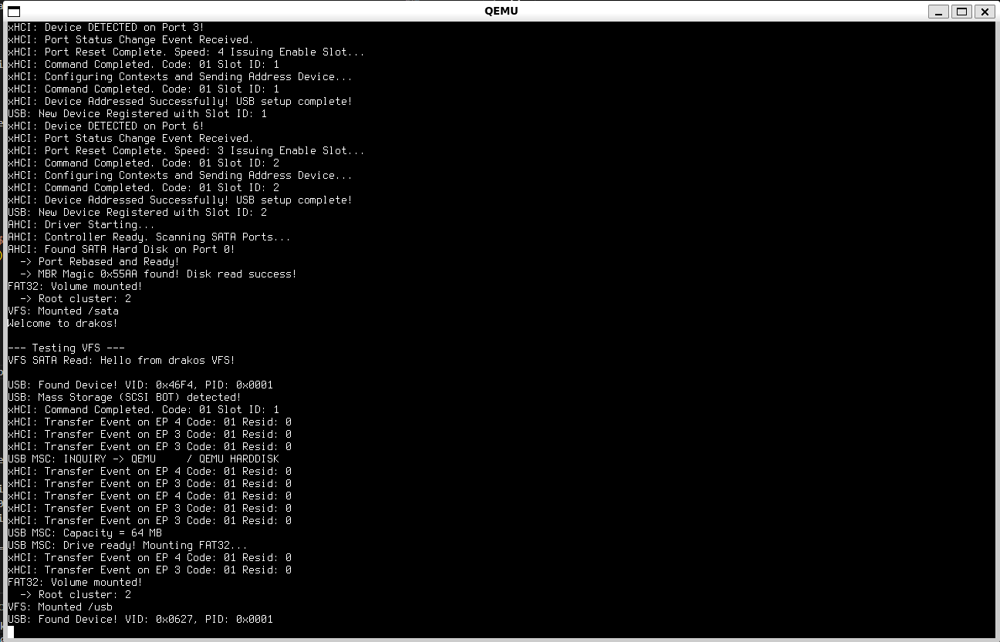

# drakos

Welcome to **drakos**! 🎮



drakos is an open-source, bare-metal operating system built from scratch in C++. 

> [!NOTE]
> 📝 Please check the **Development** tab down in the read me.

## 🎯 Our Vision

drakos aims to turn a PC into a dedicated gaming machine by minimizing OS overhead and removing everything not required for gameplay.

The goal is not to replace desktop operating systems, but to build a console-like environment on standard PC hardware.

## Current development status

drakos is an early x86-64 kernel prototype. It includes a Limine UEFI boot path, memory management, interrupt and scheduler foundations, framebuffer text output, storage and USB driver prototypes, and a small experimental userspace. The boot and driver code is not a production system, and the Game Runtime, graphics APIs, emulators, and console-style interface are not implemented.

> [!NOTE]
> I'm bringing more docs to next commits, so stay tuned.

### Build prerequisites

The following commands must be available through `PATH`:

- `x86_64-elf-gcc`, `x86_64-elf-g++`, `x86_64-elf-ld`, and `x86_64-elf-as`
- `limine`, plus its UEFI boot support files. The Makefile checks the directory reported by `limine --print-datadir` and then the executable's standard installation prefix; set `LIMINE_DIR` if the files are installed elsewhere.
- `make`, `objcopy`, and `xorriso`

To create disk images or use the full `make run` target, QEMU, OVMF, `mtools` (`mcopy`), and FAT utilities are also required. `mcopy` is not needed to compile the kernel or make the boot ISO.

The compiler prefix and Limine executable/data directory can be overridden:

```bash
make CROSS_COMPILE=x86_64-elf- LIMINE=limine
```

### Build and boot test

Build the UEFI ISO:

```bash
make all
```

Boot it in a graphical QEMU window with the installed OVMF firmware:

```bash
qemu-system-x86_64 -cpu max -bios /usr/share/ovmf/OVMF.fd -cdrom drakos.iso -m 256M
```

The Limine menu defaults to normal mode after three seconds. Select **drakos (verbose)** for initcall status, error, and TSC-duration output, or **drakos (recovery)** for detailed boot diagnostics. Normal mode suppresses kernel console and serial log output; fatal errors show a short message and direct the developer to Recovery. Verbose and Recovery modes expose the technical details. Durations are raw TSC ticks and are not calibrated wall-clock times.

For serial smoke testing, add `-display none -serial stdio -monitor none` to the QEMU command. The kernel idles after initialization, so stop QEMU with Ctrl-C when the expected boot output has appeared.

Run the host-side initcall, font, PMM, VMM/VM-region/page-cache, heap, and file-handle checks with:

```bash
make test-initcalls test-font test-pmm test-vmm test-vm-regions test-heap test-handles test-user-stack
```

The framebuffer text renderer decodes UTF-8 and uses the bundled PSF1 font's Unicode table for supported glyphs; unsupported codepoints display as `?`.

### Memory and process lifecycle status

Limine starts the reported application processors (APs), which load per-CPU GDT/TSS state, syscall stacks, and local timer state before joining the scheduler. A shared round-robin run queue schedules kernel and user threads on all enabled CPUs. Threads can migrate between CPUs at preemption points; CPU affinity is not implemented. A saved thread context is not made runnable on another CPU until the outgoing CPU has switched away from its stack. Final process cleanup is deferred until its address space is no longer active on any CPU.

Page-table operations are serialized by the VMM lock; completed map/unmap operations wait for remote CPUs to acknowledge TLB invalidations before returning or releasing owned frames. The local CPU performs its own invalidation directly. Lock waiters allow the high-priority shootdown IPI through while suppressing local timer preemption. A shootdown timeout halts the kernel before affected resources can be reused. Address-space roots have references for scheduled threads, and destruction is rejected while a root is active on any CPU or still referenced.

The heap uses a lock that preserves shootdown IPI service while waiting across CPUs, tracks small-object allocations in slab metadata, returns empty slabs and large blocks to the PMM, and defers dead-thread stack/object reclamation until execution has moved to another stack.

Each user process receives a private lower-half address space and shares the supervisor-only kernel higher half. User page-table levels and leaves carry user permissions only for user mappings. EFER.NXE is enabled on CPUs that support it; ELF non-executable segments, user stacks, and non-executable anonymous mappings are marked NX. Syscall buffers and strings are checked against user mappings before access. Runtime QEMU checks cover kernel/read-only/private-page faults, NX, invalid syscall pointers, anonymous mapping permissions, unmapping, and address-space teardown.

Kernel-side process creation has an explicit lifecycle and ownership transaction. `user_process_create_from_elf` loads an ELF image, copies bounded argument and environment strings to a one-page System V AMD64 initial stack, and publishes the thread only after initialization succeeds. The stack supplies `argc`, `argv`, `envp`, null terminators, and an `AT_NULL` auxiliary-vector terminator; libc startup passes `(argc, argv, envp)` to `main`. `make test-user-stack` checks the layout on the host, `make -C userspace args_env_test.elf` builds a small standalone validation ELF, and the four-CPU `make qemu-test-address-space` check verifies argument/environment access from ring 3. The userspace `exit` syscall terminates all threads in its process, preserves the first supplied status, and defers address-space cleanup until those threads stop; an implicit termination status defaults to zero. Parent-child ownership and `waitpid(pid, status*)` are implemented: a parent can block for one child or any child, collect status once, and orphaned children are detached safely when the parent exits. Normal boot still does not start a user process, and there is no userspace spawn syscall. See [docs/process-lifecycle.md](docs/process-lifecycle.md), [docs/elf-loading.md](docs/elf-loading.md), and [docs/user-process-launch.md](docs/user-process-launch.md).

The four-CPU QEMU runtime test checks concurrent kernel threads, concurrent ring 3 threads sharing one address space, concurrent threads in independent address spaces, syscall entry on APs, process teardown, address-space isolation, and TLB shootdowns. Run it with `make qemu-test-address-space`.

The syscall layer currently supports anonymous private mappings. Those mappings are tracked as process-scoped VM regions and allocate zero-filled pages on first access. `mprotect`, file-backed mapping syscalls, and a permission-controlled shared-memory API are not implemented. User file handles are process-scoped and generation-tagged; each handle retains a reference-counted `FileObject`, and in-flight operations retain their own reference so close cannot invalidate them. The kernel-side `vfs_*` descriptor API remains available for loader and driver code. A page cache now retains file objects and PMM-backed pages by stable file identity and page offset, shares cache entries across opens, updates cached pages after VFS writes, and reclaims unreferenced pages. File-backed VM fault resolution and Copy-on-Write are not implemented yet; file I/O is kept out of the page-fault interrupt path until the kernel has a safe deferred-I/O mechanism. On CPUs without NX support, the kernel cannot enforce execute-disable permissions. These limits mean userspace isolation remains an early kernel boundary rather than a complete process security model.

### System Service Manager status

The repository contains a host-testable userspace SSM policy core for version 1 service configuration parsing, deterministic dependency planning, required dependency failure gating, lifecycle transition validation, and bounded restart policy/backoff. Run `make test-ssm` to exercise it. The core is not yet a running service manager: although parent-child wait/reap is available, the kernel has no userspace spawn API, the normal boot path does not start an initial userspace process, and no userspace IPC/service-discovery facility exists. Therefore it cannot launch, monitor, restart, or shut down services, and no SSM QEMU runtime test is claimed. See [docs/system-service-manager.md](docs/system-service-manager.md) and [docs/roadmap.md](docs/roadmap.md) for the configuration and the incremental prerequisites.


## 💻 Development

drakos is a personally directed operating system project.

Developing a complete operating system independently is an enormous undertaking. It involves countless interconnected subsystems, complex low-level engineering, extensive testing, and years of development. For a solo developer, implementing and maintaining every component entirely by hand can become impractical.

Development began with entirely manual implementation and has since evolved into an AI-assisted workflow. AI tools, primarily OpenAI Codex, are used to accelerate implementation, architectural exploration, debugging, testing, and documentation.

The project's vision, architecture, technical direction, design decisions, requirements, and long-term roadmap remain personally directed. AI-generated contributions are reviewed, tested, and integrated as part of the development process.

The intention is not to replace personal development, but to make an ambitious project achievable. As drakos evolves, more direct implementation is planned, particularly across userspace, the graphical environment, system interfaces, and the overall user experience.

## 🤝 Contribution

Right now, drakos is a passionate project driven by a very small core team (it's mostly just me right now!), and the road ahead is massive. 

If you love low-level programming, graphics engines, or just want to be part of building something crazy and ambitious, **I need your help!**

We are especially looking for contributors who can help with:
- **USB Stack Development (xHCI):** Getting Xbox, PlayStation, and generic Bluetooth controllers to talk directly to our kernel.
- **2D/3D Graphics & Compositing:** Pushing pixels to the screen as fast as possible without a bloated desktop environment.
- **Audio Drivers:** Because gaming without sound isn't gaming.
- **Testing & Ideas:** Running drakos on real hardware, finding bugs, and brainstorming the UI.

Whether you're a seasoned kernel hacker or a C++ developer looking for a fun challenge, drop into our discussions, open an issue, or submit a pull request! Let's build the ultimate gaming OS together.
